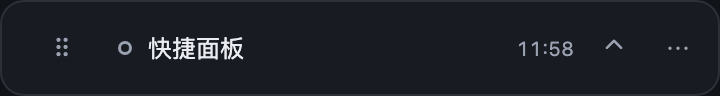
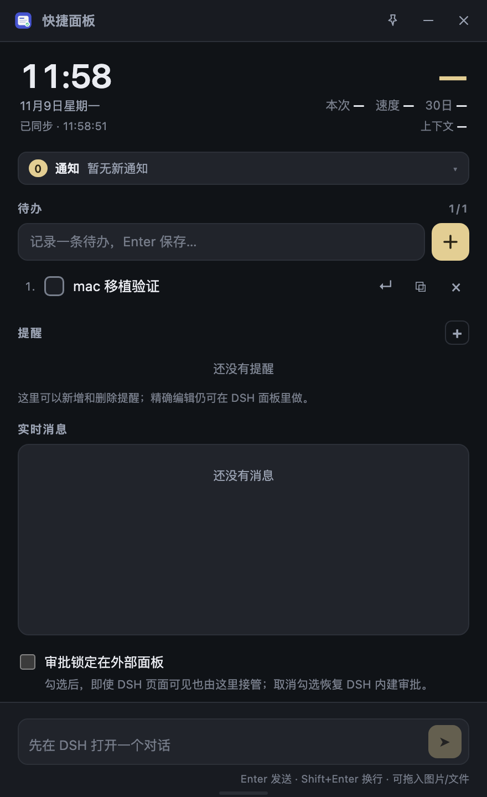

# 快捷面板 · macOS / Quick Panel for macOS

> 当前版本：1.0.4（正式版）

[](https://github.com/cinewave0/dsh-quick-panel-mac/actions/workflows/ci.yml)
[](https://github.com/cinewave0/dsh-quick-panel-mac/releases)


DSH Desktop 的快捷面板插件，**macOS 版**：在 DSH 窗口内提供一个浮岛与面板，并附带一个可常驻桌面的独立小应用（Electron 伴生窗）。

- 包名：`dsh-quick-panel-mac`，组合包声明 `dsh.bundle.platforms: ["darwin"]`，Windows 上不会出现也不会被启用。
- Windows 版在另一个仓库：[cinewave0/cinewave0-dsh-quick-panel](https://github.com/cinewave0/cinewave0-dsh-quick-panel)。两个仓库独立发布，互不影响。
- 分发：GitHub Releases + 本仓库自己的 Discover 索引（不发布 npm）。

> 改代码前先读 [AGENTS.md](AGENTS.md)：本仓库只发布 macOS 版；平台差异只能走 `runtime/electron-helper/platform.cjs`，Windows 路径保持与上游一致、不要在这里改。

- **DSH 内**：侧边栏入口 → 顶部浮岛 → 下拖面板；待办、提醒、实时消息、快速输入。
- **独立小应用**：默认顶部浮岛（360×48，置顶、不占 Dock），点开为 440 宽面板；菜单栏图标常驻；关闭面板只收起为浮岛。

> **安装或更新后必须重启 DSH：⌘Q（Command + Q）完全退出，确认 Dock 图标消失，再重新打开。只关闭窗口或刷新页面不会加载插件的页面部分。** 首次安装时 DSH 页面里的插件入口还没加载，看到“Host 未连接”不是插件坏了；按 ⌘Q 退出重开即可。Electron 运行时会在第一次打开时自动安装，不需要额外下载。

## 环境要求

- **macOS 12+**（独立小应用依赖 Electron 的窗口 API）。
- DSH Desktop（Host 半区需要 `webServer` 与 `sessionController`）。
- Electron 43.x：独立窗由 Host 拉起一个外部 Electron 进程。**首次点“打开独立面板”时，Host 会自动下载、校验并安装 Electron 43.3.0（约 120 MB，macOS arm64 / x64），然后直接开窗。** 不需要 dsh-pet，也不需要手工解压。

  - 下载源：默认先走 npmmirror CDN，失败后回退 GitHub Releases；zip 的 SHA-256 固定在校验表里，镜像无法替换二进制。
  - 自定义镜像：`DSH_QUICK_PANEL_ELECTRON_MIRROR=https://your.mirror/electron`（该目录下需有 `43.3.0/electron-v43.3.0-darwin-arm64.zip` 或 `...-x64.zip`）。
  - 已有 Electron：默认路径 `~/.dsh/electron/Electron.app/Contents/MacOS/Electron`；也可以设置 `DSH_QUICK_PANEL_ELECTRON` 指向可执行文件（重启 DSH 生效）。
  - 离线/企业环境：设置 `DSH_QUICK_PANEL_NO_RUNTIME_DOWNLOAD=1` 关闭自动下载，再按下面的命令手动安装。

  手动安装（Apple Silicon；Intel 把 `darwin-arm64` 换成 `darwin-x64`）：

  ```sh
  mkdir -p ~/.dsh/electron
  curl -L --fail -o /tmp/electron.zip \
    https://github.com/electron/electron/releases/download/v43.3.0/electron-v43.3.0-darwin-arm64.zip
  unzip -q -o /tmp/electron.zip -d ~/.dsh/electron
  test -x ~/.dsh/electron/Electron.app/Contents/MacOS/Electron && echo ok
  ```

  从浏览器下载的 zip 可能带隔离属性，必要时执行：

  ```sh
  xattr -dr com.apple.quarantine ~/.dsh/electron/Electron.app
  ```

  自动安装成功后不需要重启 DSH（Host 每次打开时解析路径）。用 `DSH_QUICK_PANEL_ELECTRON` 指向别处时，需要重启 DSH 让环境变量进入 Host 进程。路径缺失/不可执行时，面板会显示具体错误并把查找路径和 Electron stderr 写进 `~/.dsh/quick-panel/helper.log`。

## 安装

本项目**不发布 npm**，只有三个渠道：DSH 插件页（Discover 索引）、Release 包、git commit。

### 方式一：DSH 插件市场（Discover）

插件 → 发现 → 添加索引源：

```text
https://cinewave0.github.io/dsh-quick-panel-mac/market/index.json
```

然后搜索 **Quick Panel** 安装。**装完必须按 ⌘Q（Command + Q）完全退出 DSH，确认 Dock 图标消失后重新打开**；只刷新页面不够。重新打开后第一次点“打开独立面板”会自动下载并安装 Electron（约 120 MB），不需要 dsh-pet 或手工解压。索引固定到某个 commit；该 commit 的 `package.json` 版本必须与索引的 `version` 一致（`npm run check:market` 会校验，release workflow 也会跑）。

> 索引默认安装 **1.0.4 正式版**；预发布 `1.0.4-beta.6` 仍保留在索引里，想固定在旧稳定版可用 Release 包安装 `v1.0.3`。

### 方式二：Release 包

从 [Releases](https://github.com/cinewave0/dsh-quick-panel-mac/releases) 下载 `dsh-quick-panel-mac-1.0.4.tgz`，先用 `SHA256SUMS` 校验：

```sh
shasum -a 256 -c SHA256SUMS          # macOS / Linux
certutil -hashfile <tgz> SHA256      # Windows，与 SHA256SUMS 里的值比对
```

然后在 DSH 插件页的安装入口填 tgz 的**绝对路径**；装了 `dsh` CLI 的环境也可以直接用命令行：

```sh
dsh plugin --profile desktop add /绝对路径/dsh-quick-panel-mac-1.0.4.tgz
```

> 桌面版 App 不一定把 `dsh` 命令装进 `PATH`，没有 CLI 时用插件页安装即可。

### 方式三：git commit

```sh
dsh plugin --profile desktop add "git+https://github.com/cinewave0/dsh-quick-panel-mac.git#<commit>"
```

安装后：

- **修改 `client.js`、`panel/` 资源**：刷新 DSH 页面 / 重开独立窗；
- **修改 `index.js`（Host 半区）**：需要重启 DSH；
- **修改 `runtime/electron-helper/`**：托盘退出独立窗后重开。

开发目录仍可通过 `plugin_manager install_bundle target = <项目目录>` 以 link 方式挂载，详见「开发目录」。

## 使用

### DSH 内

- 侧边栏底部的快捷面板按钮打开浮岛；
- 浮岛显示最新一句 / 时间 / 运行呼吸灯；
- 点浮岛展开面板：待办、提醒、实时消息、底部快速输入；
- 待办左侧勾选 = 填入 DSH 输入框（不自动发送）；`↵` 在独立窗中填入输入框；
- 待办和提醒条目按当前显示顺序显示 `1.` `2.` 数字序号；
- 提醒支持翻页时钟、重复、提示音；
- 实时消息支持用户 / 助手 / 推理 / 代码 / 工具 / 错误、流式光标、上滚加载更早；
- 用户消息里的图片显示缩略图（Host 通过当前对话的附件引用读取，不在实时消息里传 base64）。

### 独立小应用

- DSH 面板底部的「打开独立面板」启动；默认先出现顶部浮岛；
- 点浮岛文字或 `⌃` 展开面板；拖动浮岛左侧 `⠿` 移动；
- 面板 X = 收起到浮岛；托盘菜单可打开面板 / 收起到浮岛 / 退出；
- 拖入图片或文件到窗口（底部输入框上方会出现附件条），上传完成后随下一条消息发送；单条最多 20 个附件，可逐个移除；
- 面板宽度锁定 440，高度用窗口上下边缘自由拖动：首次展开 720，之后记住你调过的高度（上限为工作区高度）；
- 用户消息缩略图可点击，在独立窗内查看原图（Esc 或点遮罩关闭）；
- 权限请求：DSH 页面可见时由 DSH 内建卡处理；DSH 页面隐藏/最小化时由独立窗接管，回到 DSH 可见后自动交还；
- DSH 的 1/2/3 选项问题会镜像到独立窗，选择/填写后可直接提交；
- DSH 不在对话页时，实时消息由 Host 继续镜像最近事件，并支持上滚加载更早；
- 「实时消息」与「在线」之间的 1–5 数字是最近 5 个会话（不显示标题），点数字即在 DSH 中切换；当前会话高亮，请求发出后目标数字脉冲，等 DSH 页面轮询处理并回报；已归档会话不出现；
- 时钟右侧显示余额（与时钟同尺寸）和本次 token 总量、输出速度、最近 30 天 token 总量（日期字号）；
- 托盘退出才会真正结束小应用。

macOS 上是同一套面板（浮岛 / 面板 / 托盘 / Dock 隐藏 / 底部拖动改高度）：





## 数据

路径以 `$DSH_HOME`（Windows `%USERPROFILE%\.dsh`，macOS `~/.dsh`）为根：

- 共享存储：`$DSH_HOME/quick-panel/state.json`（待办、提醒、设置、当前会话 id）
- 窗口位置：`$DSH_HOME/quick-panel/window.json`
- 启动诊断：`$DSH_HOME/quick-panel/helper.log`
- 独立窗 Chromium profile（仅 macOS）：`$DSH_HOME/quick-panel/user-data`（macOS 默认 userData 会被所有裸跑 Electron 的脚本共用，单实例锁也落在里面；Windows 位置不变）
- DSH 面板的本地数据会在启动时迁移到 Host 存储；Host 不可用时回退 localStorage。

## 常见问题

**打不开独立面板**

- 刚安装/更新后提示「Host 未连接」：DSH 页面还在运行旧版本。按 **⌘Q（Command + Q）** 完全退出 DSH，确认 Dock 图标消失后重新打开；只关闭窗口或刷新页面（Cmd+R / Cmd+Shift+R）不够。
- 已经按 ⌘Q 重启后仍提示「Host 未连接」：确认 Dock 图标真的消失过；再看 `~/.dsh/quick-panel/helper.log`，或重启 DSH 后重新打开插件页。
- 首次打开显示“正在下载 Electron 运行时”：这是正常的一次性安装（约 120 MB），进度会显示在面板上；下载完成后会自动开窗。失败后再点一次会重试，详情看 `~/.dsh/quick-panel/helper.log`。
- 提示启动失败 / 未就绪：看 `~/.dsh/quick-panel/helper.log`。常见原因是下载源不可达、路径不可执行、或 DSH 的地址不是本机回环地址。
- 独立窗启动后立即消失：`helper.log` 里会有 spawn/exit 记录；Electron 自己的 stderr（沙箱、`did-fail-load`）也会写进同一文件。
- 已打开但被最小化/藏到别的 Space：再点一次“打开独立面板”会通过 Electron 的第二实例通知把现有窗口拉回来。

**独立窗没有实时消息**

- 独立窗优先使用 DSH 对话页的实时镜像；离开对话页 5 秒后改用 Host 镜像；
- Host 镜像保留最近事件，上滚可加载更早；流式 partial 仍依赖 DSH 对话页；
- 如果完全没有消息，确认当前 DSH 对话与独立窗的「对话」标签一致。

**提醒不响**

- 首次使用需与页面交互一次以解锁音频；
- 独立窗打开时，DSH 面板的提醒到点逻辑会暂停，由独立窗处理；
- 独立窗关闭后，DSH 面板恢复提醒。

## 已知限制

- 支持 Windows 与 macOS；独立小应用依赖 DSH 运行与 `$DSH_HOME/electron`；
- macOS 差异：浮岛不占 Dock（`app.dock.hide()`）、面板用带隐藏标题栏的真实窗口获得原生高度缩放边（宽度锁 440）、菜单栏图标用模板图（随深浅色自动反色）、通知以 Electron 身份出现（未做 `.app` 签名打包）；
- 独立窗实时消息：Host 能在 DSH 离开对话页后继续镜像新的已结算事件，并在上滚时从 Host 会话事件加载更早；流式 partial 仍依赖 DSH 对话页；
- 独立窗问题卡：当前会话的 pending 问题会镜像；多题用上一题/下一题，提交后等待 DSH 确认；
- 独立窗会话切换：数字按钮只负责发起请求，真正切换发生在 DSH 页面内的客户端插件（轮询间隔约 2.5 秒）；DSH 页面关闭或插件未加载时请求会在 30 秒后过期，界面不报错也不切换；
- 图片缩略图：DSH 面板覆盖已加载的历史消息；独立窗覆盖 Host 镜像的当前窗口；原图由 Host 按附件引用按需读取，超过 16 MiB 的附件不预览；
- 通知中心：面板时钟下方常驻通知条，记录**审批请求、轮次结束、提醒到点**；未读显示角标，点开查看最近 20 条，审批条目可跳回审批卡，支持一键清空。记录存在面板 localStorage（DSH 重启换端口会清空）。
- 权限批准卡：默认在 DSH 页面可见时显示 DSH 内建卡；DSH 页面隐藏、独立窗心跳在线且当前对话匹配时由外部面板接管。外部面板「实时消息」下方的**审批锁定在外部面板**勾选后，即使 DSH 可见也由外部面板接管；取消勾选恢复 DSH 内建审批。审批被接管时面板会响提示音并弹桌面通知（标题含工具名，回答后通知关闭）。关闭独立窗或心跳丢失时始终交还 DSH；不再有 120 秒超时兜底；
- 时间栏的“30 日”是本机 DSH 会话投影的近似总量（含缓存读取），不是平台账单；余额需要已登录 DeepSeek 账号，API Key 模式显示 `—`，余额缓存约 5 分钟；
- 多显示器/跨 DPI 场景未完整验证；
- 本次启动/错误处理改动（spawn 就绪等待、URL 白名单、`did-fail-load`）在 macOS 实机验证；Windows 路径保持原行为，但未在 Windows 实机回归；
- 独立窗提醒与 DSH 面板的“单一负责人”协调仍在完善。

## 开发目录

```
index.js                     Host：共享存储、本地 API（含图片附件读取）、live、prompt/stop、静态资源
client.js                    DSH 客户端（构建产物；编辑 src/client/ 后重新构建）
src/client/main.js           DSH 客户端入口：apply 与槽位注册
src/client/dsh.js            DSH 服务适配层（能力检测 + 降级）
src/client/session.js        store/模式/待办/提醒/HostSync
src/client/overlay.js 等     组件与工具模块（overlay/sections/feed/input/panel/bridges）
src/client/runtime.js        React 绑定（DSH 的 require('react') 注入）
panel/                       独立窗页面（HTML/CSS/JS/icon）
runtime/electron-helper/     独立窗主进程与 preload
locale/                      插件标题/描述
scripts/                     构建、备份、GitHub 同步、市场索引生成
test/                        Host 回归、客户端 bundle/适配层/源码导入、Electron 面板测试
```

## 开发命令

```sh
node scripts/build-client.mjs                    # 由 src/client 生成 client.js
node test/host.test.mjs                          # Host 回归（11 项）
node test/client-bundle.test.mjs                 # 客户端 bundle 信封/工厂形状
node test/dsh-adapter.test.mjs                   # DSH 服务适配层与降级路径
node test/source-imports.test.mjs                # 源码模块导入完整性
node test/platform.test.mjs                      # 平台规则（托盘/Dock/置顶/菜单）
node test/panel.test.mjs                         # Electron 面板 DOM 集成测试（需 $DSH_HOME/electron）
node test/helper.test.mjs                        # 真实 Electron helper 启动/首次 ping 冒烟测试（需 Electron）
node test/runtime-install.test.mjs               # 首次打开时 Electron 下载/校验/解压/安装
node test/restart-prompt.test.mjs                # 安装后的重启提示（⌘Q、仅刷新不够）
npm run lint                                     # oxlint（0 warning 门槛）
npm run check:market                             # Discover 索引 version 与 commit 的 package.json 一致
node scripts/backup.mjs                          # 备份到 ../backups（zip + sha256 + manifest）
node scripts/sync-github.mjs --message "..."     # 提交 + 测试 + push
node scripts/sync-github.mjs --dry-run           # 只看计划，不提交不推送
node scripts/sync-github.mjs --proxy http://127.0.0.1:7897 --message "..."  # 直连被重置时走本机代理
```

`client.js` 是生成文件，直接改它会在下一次构建时被覆盖；CI 会用 `git diff --exit-code client.js` 检查源码与产物是否一致。

## License

MIT
